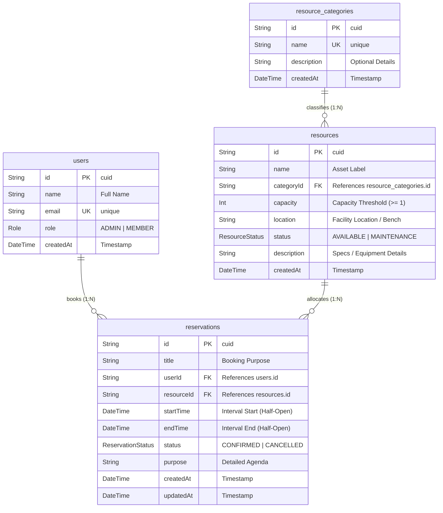

# PrimeReserve &mdash; Entity-Relationship (ER) Architecture

This document provides the formal Database Schema and Entity-Relationship specifications for the **PrimeReserve Resource Reservation Management System**, designed for high-concurrency conflict elimination on PostgreSQL.

---

## 1. Interactive Diagram (dbdiagram.io DBML)

To view or render this diagram interactively on [dbdiagram.io](https://dbdiagram.io):
1. Navigate to **[dbdiagram.io](https://dbdiagram.io)**.
2. Paste the following **DBML (Database Markup Language)** code into the editor:

```dbml
// PrimeReserve - Enterprise Resource Reservation System Schema
// Optimized for PostgreSQL with Composite B-Tree Concurrency Indexing

Enum Role {
  ADMIN [note: 'System administrators with resource management privileges']
  MEMBER [note: 'Standard organization members capable of creating reservations']
}

Enum ResourceStatus {
  AVAILABLE [note: 'Operational and ready for scheduling']
  MAINTENANCE [note: 'Under maintenance or calibration; strictly blocks all bookings']
}

Enum ReservationStatus {
  CONFIRMED [note: 'Active booking occupying a temporal slot']
  CANCELLED [note: 'Soft-cancelled booking retaining audit history; releases slot']
}

Table users {
  id varchar [pk, note: 'Unique CUID identifier']
  name varchar [not null]
  email varchar [unique, not null]
  role Role [not null, default: 'MEMBER']
  createdAt timestamp [default: `now()`]

  Note: 'Personnel directory supporting role-based access'
}

Table resource_categories {
  id varchar [pk, note: 'Unique CUID identifier']
  name varchar [unique, not null, note: 'Conference Rooms, Testing Equipment, Company Fleet, etc.']
  description text
  createdAt timestamp [default: `now()`]

  Note: 'Taxonomic categorization of physical organizational assets'
}

Table resources {
  id varchar [pk, note: 'Unique CUID identifier']
  name varchar [not null]
  categoryId varchar [not null, ref: > resource_categories.id]
  capacity integer [not null, default: 1]
  location varchar [not null]
  status ResourceStatus [not null, default: 'AVAILABLE']
  description text
  createdAt timestamp [default: `now()`]

  indexes {
    categoryId
    status
  }

  Note: 'Physical equipment and spaces available for shared corporate reservation'
}

Table reservations {
  id varchar [pk, note: 'Unique CUID identifier']
  title varchar [not null]
  userId varchar [not null, ref: > users.id]
  resourceId varchar [not null, ref: > resources.id]
  startTime timestamp [not null]
  endTime timestamp [not null]
  status ReservationStatus [not null, default: 'CONFIRMED']
  purpose text
  createdAt timestamp [default: `now()`]
  updatedAt timestamp [default: `now()`]

  indexes {
    (resourceId, startTime, endTime) [name: 'idx_reservations_conflict_lookup', note: 'Composite index for sub-millisecond collision detection']
    userId
    status
    startTime
  }

  Note: 'Temporal resource allocations evaluated via half-open interval algebra'
}
```

---

## 2. Visual Entity-Relationship Diagram (Mermaid)



---

## 3. Relational Cardinality & Referential Integrity

| Primary Table | Foreign Table | Relationship | Foreign Key | Cascade Policy |
| :--- | :--- | :---: | :--- | :--- |
| `resource_categories` | `resources` | **1 : N** | `resources.categoryId` $\rightarrow$ `resource_categories.id` | `ON DELETE CASCADE` |
| `users` | `reservations` | **1 : N** | `reservations.userId` $\rightarrow$ `users.id` | `ON DELETE CASCADE` |
| `resources` | `reservations` | **1 : N** | `reservations.resourceId` $\rightarrow$ `resources.id` | `ON DELETE CASCADE` |

---

## 4. Indexing & Concurrency Rationale

### The Composite Conflict Index
The database includes a composite compound B-Tree index:
```sql
CREATE INDEX idx_reservations_conflict_lookup ON reservations (resourceId, startTime, endTime);
```

#### Why this index is critical:
In high-concurrency reservation engines, read queries verifying overlap occur with every single reservation attempt. The collision condition is:
```sql
WHERE resourceId = $1
  AND status != 'CANCELLED'
  AND startTime < $newEndTime
  AND endTime > $newStartTime;
```
Without this composite index, PostgreSQL must execute a sequential table scan across all past and future records. With this compound index, PostgreSQL isolates the specific `resourceId` partition in $O(\log N)$ time, scanning only the relevant temporal bounding box.
